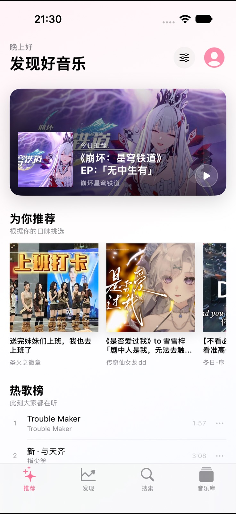
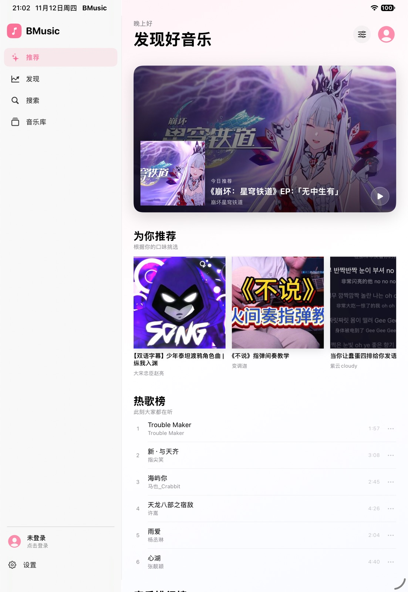
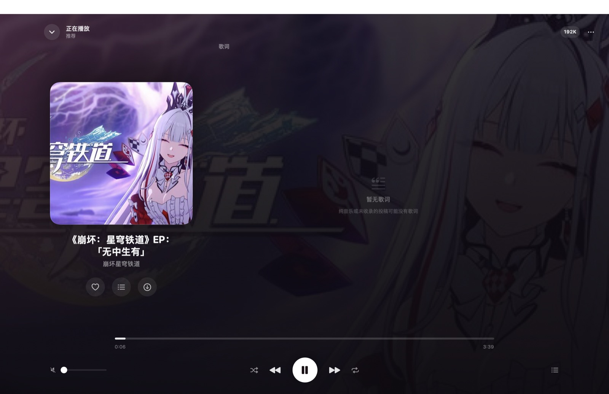
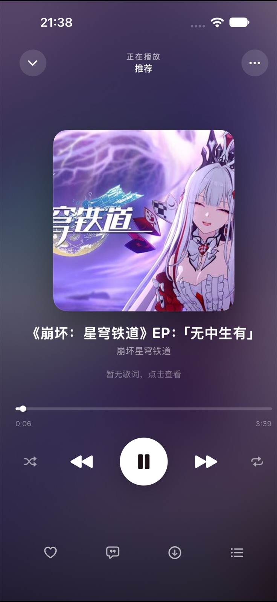
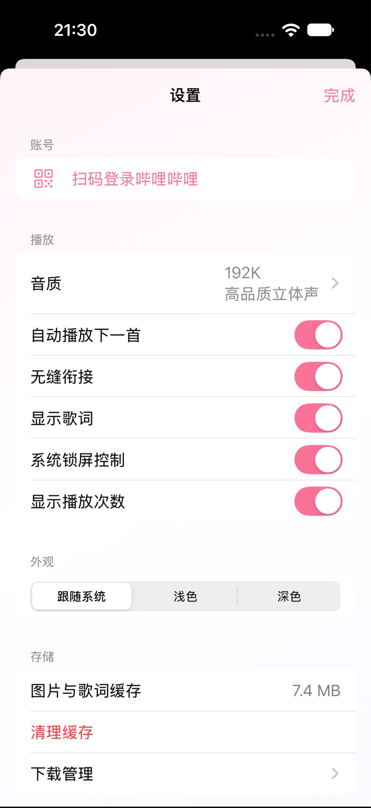

# BMusic

BMusic 是一个使用 SwiftUI 编写的哔哩哔哩音乐播放器，覆盖 iPhone、iPad 与 Mac。界面采用原生、克制的布局与粉调强调色，播放核心使用 libmpv，不依赖 WebView，也不使用 AVPlayer 顶替音频解码。

> BMusic 是非官方客户端，与哔哩哔哩无隶属关系。请使用自己的账号登录，并遵守平台服务条款。

## 截图

| iPhone | iPad | Mac |
| --- | --- | --- |
|  |  |  |
|  | | |
|  | | |
|  |  | |

## 功能

- **推荐与发现**：首页编辑精选、个性化推荐、热歌榜；发现页按分区浏览。
- **搜索**：单曲 / UP 主 / 影视三类结果，搜索建议与最近搜索，支持直接粘贴 BV 号。
- **播放**：libmpv 解码 B 站音频流；播放 / 暂停、上一首 / 下一首、进度拖动、音量、随机与循环、自动连播、无缝衔接。
- **音质**：128K / 192K / 320K / Hi-Res / 杜比，按账号权益自动回落。
- **歌词**：优先 B 站视频字幕，其次网易云、LRCLIB 在线歌词；逐行高亮、点击跳转、全屏歌词页。
- **队列**：查看接下来播放的歌曲，随时跳转或清空。
- **音乐库**：喜欢的音乐、最近播放、自建歌单、B 站收藏夹（登录后同步）。
- **下载**：将当前歌曲保存到本地，离线播放与管理。
- **登录**：三种方式 —— 哔哩哔哩 App 扫码、手机号短信验证码、账号密码（RSA 加密提交）。短信与密码登录前会弹出极验人机验证；仅在本机保存 Cookie，不接触账号密码存储。
- **系统集成**：控制中心 / 锁屏 / 媒体键（可关闭）、后台播放、深浅色外观。
- **隐私**：没有麦克风、相机、通讯录、相册、定位、Apple Events 或 Keychain 调用。

## 平台与要求

| 平台 | 最低版本 | 产物 |
| --- | --- | --- |
| iOS / iPadOS | 17.0 | 未签名 IPA，可用 LiveContainer 或自签安装 |
| macOS | 15.0 | `BMusic.app` |

开发环境：Xcode 16 或更新版本、Swift 6.2+。首次构建需要联网解析 [MPVKit](https://github.com/mpvkit/MPVKit)。

## 构建

### macOS

```bash
./Scripts/build-app.sh release
open build/BMusic.app
```

产物为 `build/BMusic.app`，仅做本地 ad-hoc 签名，不查询开发者证书或钥匙串。

### iOS / iPadOS

```bash
./Scripts/build-ios.sh
```

脚本使用 Xcode 工程构建 arm64 Release，并打包为：

```text
build/BMusic-unsigned.ipa
```

该 IPA **未签名**，可直接拖入 LiveContainer 测试；安装到真机时需要用自己的证书重签。脚本不会请求开发者账号，也不会写入描述文件。

也可以打开 `BMusic.xcodeproj`，选择 `BMusic-iOS` scheme 后运行。首次打开需允许 Xcode 解析 MPVKit 包。

### 命令行 SwiftPM

```bash
export PATH="/Applications/Xcode.app/Contents/Developer/Toolchains/XcodeDefault.xctoolchain/usr/bin:$PATH"

# macOS
swift build -c release

# iOS device
swift build -c release \
  --triple arm64-apple-ios17.0 \
  --sdk "$(xcrun --sdk iphoneos --show-sdk-path)"
```

## 自动化构建

仓库自带 GitHub Actions（`.github/workflows/build.yml`）：

- 推送到 `main` 或手动触发 workflow 时，自动构建 macOS Release 与 iOS 未签名 IPA，并以 Artifact 形式上传。
- 每次构建后自动刷新滚动发布的 [latest 预发布](https://github.com/MiQieR/BMusic/releases/tag/latest)，始终附最新 DMG 与 IPA。
- 推送 `v*` 形式的标签（如 `v1.0.1`）时，额外发布对应的稳定版 GitHub Release。

DMG 内含 `BMusic.app` 与指向 `/Applications` 的快捷方式，拖拽即可完成安装。

## 目录结构

```text
Sources/BMusic/
  App/            macOS 应用入口、侧栏、顶栏与播放条
  Core/           B 站 API、WBI 签名、Cookie、模型与本地存储
  DesignSystem/   颜色、字体、封面与通用组件
  Features/       macOS 页面
  IOS/            iOS / iPadOS 页面与导航
  Playback/       libmpv 封装、播放服务、歌词服务
Resources/        Info.plist、App 图标与 Asset Catalog
Scripts/          macOS 与 iOS 构建脚本
```

macOS 与 iOS 共用 Core、Playback 与 DesignSystem；平台专属视图通过 `#if os(...)` 隔离。

## 数据位置

- macOS：`~/Library/Application Support/BMusic`
- iOS：应用沙盒内的 Application Support / Caches
- 登录 Cookie：`session/cookies.json`
- 下载：`Downloads/`

清除缓存不会退出登录；退出登录会删除本机 Cookie。

## 已知限制

- 接口来自哔哩哔哩公开 Web / App API，平台调整后可能需要更新。
- Hi-Res、杜比与部分高码率音频依赖账号权益，不可用时自动回落。
- 下载内容仅供个人离线收听，请勿传播。
- 影视类搜索结果仅展示，不提供播放。

## 致谢

- [libmpv](https://github.com/mpv-player/mpv) 与 [MPVKit](https://github.com/mpvkit/MPVKit) 提供解码与音频输出。
- 哔哩哔哩开放 Web 接口与各位 UP 主的音乐内容。
